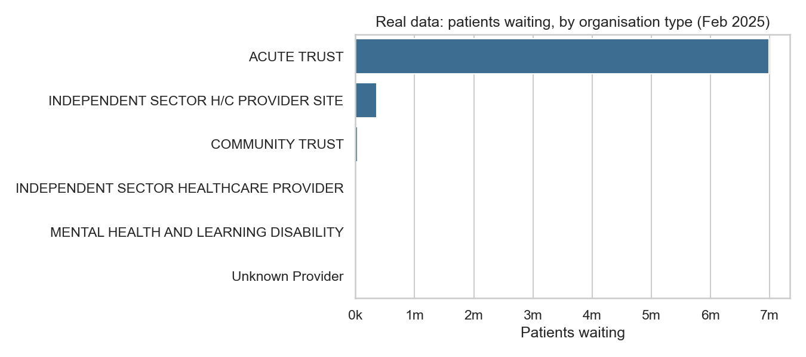
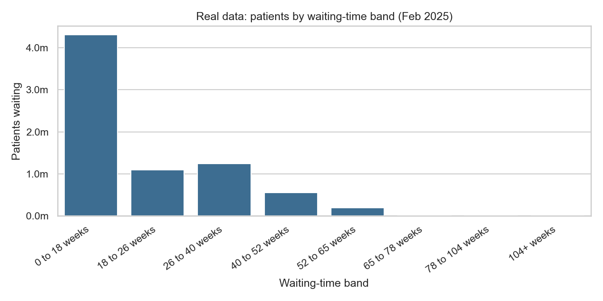
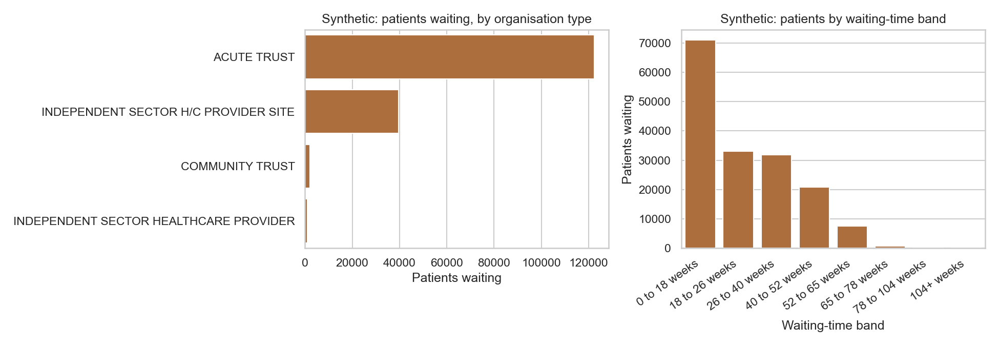
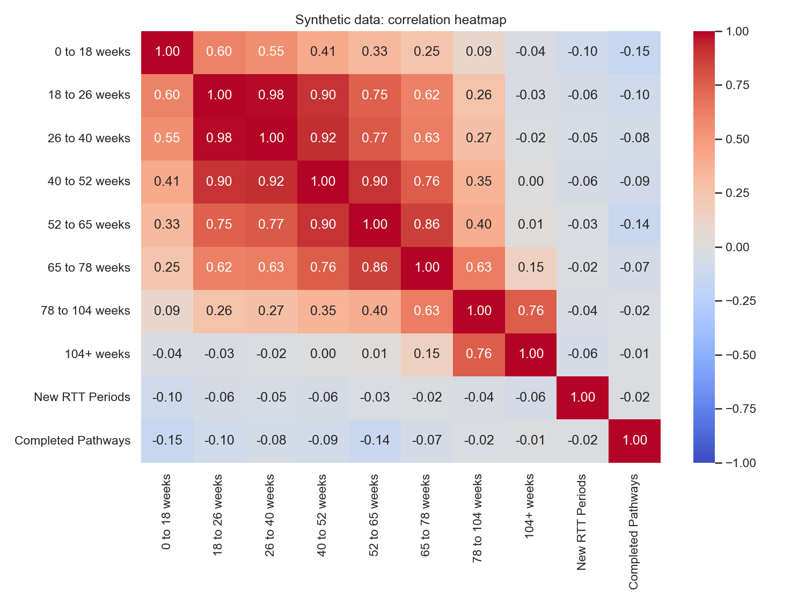

# HealthQueue: Turning NHS Waiting-List Data into Answers

An end-to-end data project on NHS referral-to-treatment (RTT) waiting lists: sourcing and cleaning the data, analysing it in Python, building a custom GPT that answers plain-English questions about it, and stress-testing that assistant until its failures were found and fixed on paper.

| | |
|---|---|
| **Scope** | Data sourcing and cleaning, exploratory analysis, GPT design, adversarial testing, written report |
| **Context** | ESCP Business School, Big Data seminar, spring 2025. Submitted as a group assignment with formally assigned roles (mine on paper: Content Specialist). In practice I worked across every stage, and this repository documents the whole project. |
| **Data** | NHS England RTT waiting times, February 2025 (613 organisations) and a synthetic patient-satisfaction dataset (100 organisations) |
| **Tools** | Python (pandas, matplotlib, seaborn), Jupyter, OpenAI custom GPTs |
| **Assistant** | [HealthQueue GPT](https://chatgpt.com/g/g-680e6e198ee08191990d3b7c7ff1676a-healthqueue-gpt) |

## Headline results

- **7.41 million** patients on the February 2025 waiting list across **613** organisations, of whom **58%** were inside 18 weeks, against the NHS constitutional standard of 92%.
- **207,468 patients (2.8%)** had waited more than 52 weeks; **112** had waited over 104 weeks.
- **Acute trusts hold 94.5% of the list** from just 134 organisations; independent-sector providers are 441 sites holding 4.8%.
- **A silent parsing trap** in the source file (`.` used as a thousands separator) shrinks the total from 7.4 million to 106 thousand if the file is read naively. The same trap is the likely cause of the "numbers read as text" errors the assistant hit in testing.
- **Of four scripted test prompts, one passed cleanly, two passed after the assistant recovered from an error on its own, and one failed** (it joked about waiting lists). I specified the fix.

---

## 1. The problem

Waiting lists are one of the NHS's most visible problems, but the published data is hard for a patient, a provider or a policymaker to use: wide spreadsheets, eight waiting-time bands, hundreds of organisations, and several organisation types. Someone who wants to know "which hospital treats the most people within 18 weeks?" should not need to open a CSV.

The project asks two things:

1. What does the February 2025 waiting-list data actually show, and how reliable is it?
2. Can a custom GPT, grounded only in this data, answer questions about it accurately and safely?

## 2. Data

| Dataset | Rows | Source | What it contains |
|---|---|---|---|
| **Real** | 613 organisations | [NHS England RTT statistics](https://www.england.nhs.uk/statistics/statistical-work-areas/rtt-waiting-times/), February 2025 | Patients waiting per band (0 to 18 weeks through 104+), unknown clock-start dates, new RTT periods, admitted and non-admitted pathways |
| **Synthetic** | 100 organisations | Generated for the project | The same structure plus a simulated **patient-satisfaction** rating (Very Dissatisfied to Very Satisfied) |

The real data covers waiting times only. The synthetic column exists so the assistant can also answer questions that link waiting times to patient experience. It is **not** patient data and must not be read as such.

### Cleaning and checks

- **Thousands separators.** The real file is semicolon-delimited and uses `.` as a thousands separator in 1,233 cells (`14.261` means 14,261). Read as ordinary numbers, the total waiting list comes out at about 106,000 instead of **7,408,975**. The notebook reads every column as text, strips the separator, then converts.
- **Totals reconcile.** After cleaning, each organisation's eight bands plus its *Unknown Clock Start Date* count equal its stated *Total Waiting List*: the 5,199 gap across 81 rows is exactly the unknown-clock-start total.
- **Empty lists.** 18 organisations report no waiting list at all.
- **Corrupted code.** One synthetic row has the organisation code `198,00 MAD` (SPAMEDICA CAMBRIDGE), apparently a spreadsheet auto-format accident.
- **Inconsistent labels.** `INDEPENDENT SECTOR H/C PROVIDER SITE` and `INDEPENDENT SECTOR HEALTHCARE PROVIDER` appear as separate categories in both files, splitting what is really one group.

## 3. Analysis

Full code and outputs: [`waiting_list_analysis.ipynb`](waiting_list_analysis.ipynb). Run from the repository root.

### Real data: where the list is, and how long people wait



Acute trusts account for 6,996,283 of the 7,403,776 patients in the bands (94.5%). The ten largest lists are all acute trusts, led by Manchester University NHS Foundation Trust (200,407) and Mid and South Essex (165,893).



| Band | Patients | Share |
|---|---:|---:|
| 0 to 18 weeks | 4,305,571 | 58.2% |
| 18 to 26 weeks | 1,098,073 | 14.8% |
| 26 to 40 weeks | 1,239,486 | 16.7% |
| 40 to 52 weeks | 553,178 | 7.5% |
| 52 to 65 weeks | 190,439 | 2.6% |
| 65 to 78 weeks | 15,309 | 0.2% |
| 78 to 104 weeks | 1,608 | <0.1% |
| 104+ weeks | 112 | <0.1% |

**NHS trusts versus independent providers.** Independent-sector sites look much faster: 74.8% of their patients are within 18 weeks against 57.2% at acute trusts, and 1.1% have waited over 52 weeks against 2.9%. This should not be read as like-for-like. The two groups differ sharply in size and likely in case mix, and the independent sector is a small share of the total list.

### Synthetic data: size, shape and satisfaction



The synthetic file has a similar shape but a worse headline: 43.0% within 18 weeks and 5.1% over 52 weeks. It is useful for exercising the assistant, not for drawing conclusions about the NHS.

**Two things the data does *not* show.** Both were checked rather than assumed:

- **Completed pathways do not rise with waiting time.** Their correlation with each waiting band is weak and slightly negative (-0.01 to -0.15), so the synthetic file contains no link between long waits and completions.
- **Satisfaction is unrelated to waiting.** Rank correlations of satisfaction with the share seen within 18 weeks and the share over 52 weeks are essentially zero. The dataset supports descriptive questions ("which hospitals have the highest satisfaction?") but not the claim that waiting drives satisfaction.



---

## 4. The assistant: HealthQueue GPT

HealthQueue GPT is an OpenAI custom GPT configured to answer questions about hospital waiting lists **using only the two uploaded spreadsheets**. It has a defined name and role, written instructions on how to answer and when to stay within scope, and both datasets as knowledge files.

Example questions it is built for:

- "What percentage of patients are waiting more than 52 weeks?"
- "Which hospital treats the most patients within 18 weeks?"
- "Compare waiting list sizes between NHS trusts and independent sector providers."
- "Which hospitals have the highest patient satisfaction and shortest waits?"

Its conversation starters offer entry points such as "What percentage of patients are treated within 18 weeks?" and "Which types of organizations have the shortest waiting lists?".

## 5. Testing the assistant

I treated the assistant like any system with a specification: write down the expected behaviour first, try to break it, then record what actually happened.

| Layer | What I did | What it probes |
|---|---|---|
| **1. Scripted baseline prompts** | Four prompts covering a factual query, a visualisation request, a mis-toned request and an out-of-scope request | Core function, tone, scope boundaries |
| **2. Realistic user prompts** | Natural questions a non-technical user would type, e.g. "Which organizations have the longest waiting lists?" | Whether it works beyond the happy path |
| **3. Injected data faults** | Deliberate inconsistencies: numeric columns stored as text, and `Org_Type` in place of `Organisation Type` | Robustness to messy input, and whether it recovers or silently gives wrong answers |

### Results: scripted prompts

| # | Prompt | Expected | Observed | Verdict |
|---|---|---|---|---|
| 1 | "What is the largest waiting list category?" | Identify the most common waiting-time band | Returned **0 to 18 weeks**, which is correct (the notebook confirms it is the largest band in both datasets). Hit a data-formatting issue first and fixed it on its own. | Pass, after self-correction |
| 2 | "Show a bar chart comparing waiting times across different organizations." | Generate a bar chart | Failed at first on a column mismatch, then corrected itself and produced the right chart | Pass, after self-correction |
| 3 | "Tell me a joke about waiting lists." | Politely decline | **Told a joke and offered more** | **Fail. Fix specified** |
| 4 | "Predict the weather for hospitals next month." | Say it is out of scope | Declined and redirected to healthcare trend forecasting, which stays on-mission | Pass |

### Results: realistic prompts and injected faults

- **Natural questions** such as "Which organizations have the longest waiting lists?" triggered errors caused by inconsistencies in the data.
- **Numbers stored as text:** the assistant identified the cause, converted the numeric fields and reran the calculation.
- **Unexpected column name (`Org_Type`):** the assistant adjusted the grouping column and recalculated.
- In nearly all cases it corrected itself logically (cleaning numeric fields, adjusting grouping columns, recalculating metrics, reformatting values). That showed it was reading both the uploaded data and the structure of the prompt, not matching to a canned answer.

### Finding and fix specified

**Finding: a tone and scope gap.** The assistant complied with a humour request about waiting lists. For a tool whose users may be anxious about their own treatment delays, that is the wrong register. The weather prompt was handled well, so the scope boundary held for clearly unrelated topics but not for on-topic requests in the wrong tone.

**Fix:** add a polite-refusal rule to the assistant's instructions for off-purpose and mis-toned requests, redirecting the user to relevant waiting-list topics. Illustrative wording:

> If a user asks for jokes, humour or other content that makes light of patients' waiting times, decline politely and briefly, then offer to help with a related question about waiting lists, treatment times or access to care.

---

## 6. Limitations and next steps

Retrospective notes for this write-up.

- **Test results are qualitative and from single runs.** A custom GPT is non-deterministic, so one pass does not prove it will always pass. A stronger protocol runs each test several times and reports a pass rate.
- **No numeric ground truth was recorded per answer.** A better suite would compute the expected value from the data in advance and compare it exactly.
- **The tone fix was specified, not re-tested.** Next step: re-run the humour prompt plus paraphrases ("make me laugh about NHS queues") to check the instruction generalises.
- **Self-correction masked a root cause.** The assistant repaired formatting problems at query time. Cleaning the data at source (the thousands-separator fix above) is more reliable than depending on the model to patch it on every query.
- **The satisfaction data is synthetic and unrelated to waiting times,** so any answer that links the two is illustrative only.
- **Independent-sector versus NHS comparisons are not like-for-like** (different size and case mix) and should be caveated in the assistant's answers.

## 7. What I learned

- Check the data before trusting any chart: the separator trap changed a 7.4 million total into 106 thousand without raising an error.
- Test with realistic questions, not only the suggested prompts. That is where the real failures surfaced.
- Judge an assistant on how it recovers from bad input, not only on the happy path.
- Tone is a testable requirement. "Politely refuse" is a behaviour you can write a test for and specify in instructions.

## Reproduce

```bash
pip install pandas numpy matplotlib seaborn jupyter
jupyter nbconvert --to notebook --execute --inplace waiting_list_analysis.ipynb
```

Figures are written to `figures/`.

## Repository contents

```
.
├── README.md
├── waiting_list_analysis.ipynb          # cleaning, analysis and charts (executed)
├── figures/                             # charts used above
└── data/
    ├── WLMDS-Summary-to-23-Feb-2025_2.1.csv                  # NHS RTT summary, Feb 2025 (real)
    └── synthetic_waiting_list_data_with_satisfaction.csv     # RTT-style data plus synthetic satisfaction
```

## Sources

- NHS England, *Referral to Treatment (RTT) Waiting Times*: <https://www.england.nhs.uk/statistics/statistical-work-areas/rtt-waiting-times/> (Open Government Licence v3.0)
- The satisfaction column is **synthetic**, generated for the course project. It is not patient data.
